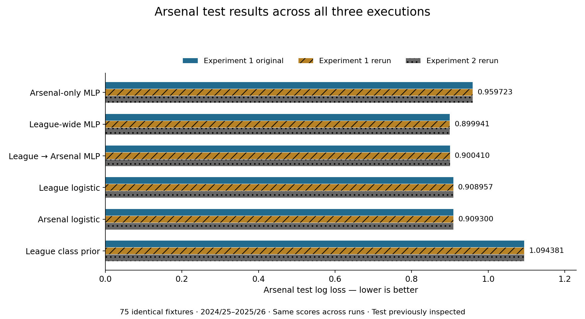
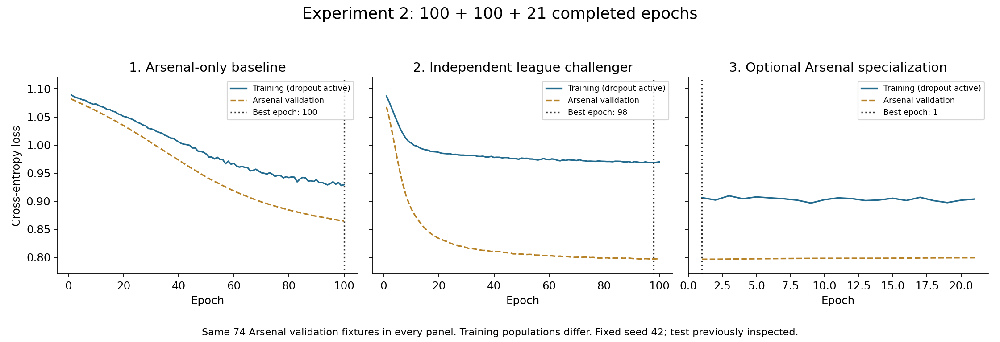

# Premier League Research

Reproducible research on Arsenal win/draw/loss probabilities using frozen Premier League match data.

**[Scientific report](docs/scientific_report.md)** · **[Protocol](EXPERIMENT_PROTOCOL.md)** · **[Results catalog](results/README.md)** · **[Reproduce](docs/reproduction.md)** · **[Revision log](docs/cleanup_2026-10-26.md)**

## Study at a glance

The control is an MLP trained on **815 Arsenal fixtures**. The treatment is the same MLP trained independently on **7,977 EPL fixtures**, including Arsenal. An optional extension fine-tunes the league checkpoint on Arsenal. Checkpoints use the same **74 Arsenal validation fixtures**; evaluation uses the same **75 later Arsenal test fixtures**.

**The reruns are labeled as reproducibility checks after test inspection.** Reordering independent fits with the same per-fit seed reproduces identical results; it does not constitute a new modeling treatment or independent confirmation. The current cleanup changes organization and presentation, not the experimental question or results.

## Results



| Model | Test log loss ↓ | Brier sum ↓ | Accuracy |
|---|---:|---:|---:|
| Arsenal-only MLP — control | 0.959723 | 0.569044 | 60.00% |
| League-wide MLP — treatment | 0.899941 | 0.529087 | 61.33% |
| League → Arsenal MLP | 0.900410 | 0.529357 | 61.33% |
| League logistic | 0.908957 | 0.532644 | 61.33% |
| Arsenal logistic | 0.909300 | 0.534445 | 64.00% |
| League class prior | 1.094381 | 0.664183 | 40.00% |

On these historical fixtures, league MLP minus Arsenal MLP log loss is **−0.059782**, with a month-block 95% interval **[−0.100787, −0.016194]**. The interval excludes training-seed uncertainty. **League logistic is the validation-selected candidate**; the test ranking does not change selection. One seed, a short inspected test period and unequal optimizer-update budgets limit interpretation.

[Metric definitions, methods and limitations](docs/scientific_report.md) · [Exact chart data](results/profile/test_results.csv)

## Workflow and training evidence

**Arsenal baseline → independent league challenger → frozen validation comparison → optional Arsenal specialization → final test evaluation.** Only specialization inherits trained weights.



Fixed settings: 39→32→16→3 MLP, ReLU/dropout 0.1, unweighted cross-entropy, AdamW 1e-4, weight decay 0.01, batch 256, seed 42, maximum 100 epochs per fit, patience 20. Both independent fits reached 100 epochs; specialization stopped at 21 and selected epoch 1. Training loss uses different populations and active dropout; validation uses the same Arsenal population without dropout.

- **[Experiment 2: executed notebook](notebooks/Experiment_2_Epoch_By_Epoch.ipynb)** · [All 221 epochs](results/experiment_2/run_20261026T002413/EVERY_EPOCH.md)
- **[Experiment 1: fresh verification notebook](notebooks/Experiment_1_Fresh_Verification.ipynb)** · [Every epoch and equality checks](results/run_20261026T003158/RERUN_REPORT.md)
- [Original experiment 1 notebook](notebooks/Arsenal_League_vs_Arsenal.ipynb) · [All historical runs and source commits](results/README.md)

## Repository map

| Location | Responsibility |
|---|---|
| [docs/](docs/README.md) | Scientific report, workflow explanation, reproduction guide and revision/deletion records |
| [arsenal_predictor_v1/](arsenal_predictor_v1/README.md) | Frozen original source bundle, cleaned data, splits, schema, attribution and checksums |
| [experiments/](experiments/README.md) | Training, evaluation, inference, audit, run resolution and figure generation |
| [notebooks/](notebooks/README.md) | Executed experiment narratives and evidence |
| [results/](results/README.md) | Registered runs, metrics, predictions, checkpoints, epoch logs, audits and graphics |
| [tests/](tests/README.md) | Behavioral, provenance and preservation checks |

The original bundle name and run paths remain stable for provenance. A catalog distinguishes featured outputs from historical runs; no earlier execution is silently discarded.

## Reproduce and inspect

Python 3.12; install the pinned runtime requirements, then:

```bash
python -m unittest discover -s tests -v
python -m experiments.verify_repository
```

[Full installation, historical-source recovery and rerun instructions](docs/reproduction.md). No training is required to inspect saved results. Original experiment 1 source and archived scientific artifacts are preserved byte for byte.

## Data attribution and scope

Read [DATA_REUSE_NOTICE.md](DATA_REUSE_NOTICE.md) before redistribution. Third-party restrictions, including Reza's stated CC BY-NC 4.0, remain applicable; original-provider lineage is incomplete. No commercial clearance is implied. This is historical research, not a live forecasting service. Repository visibility is unchanged by the cleanup.
