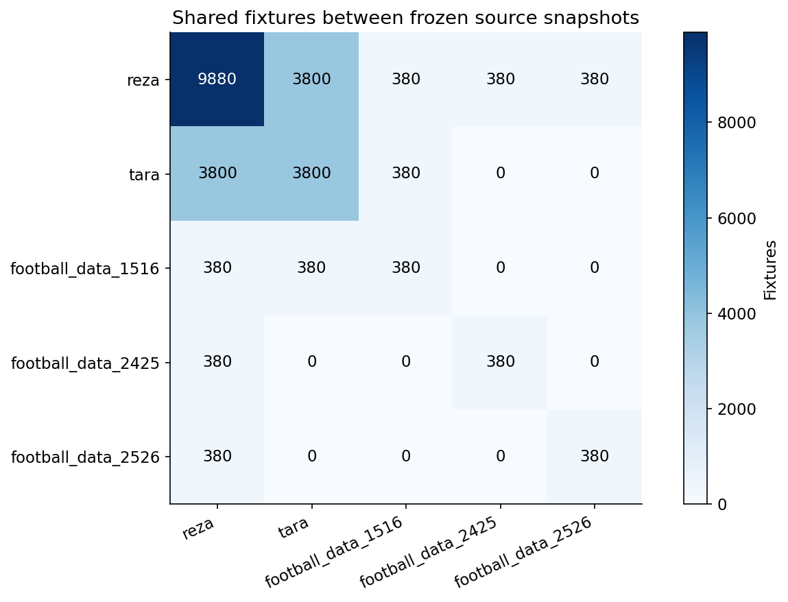
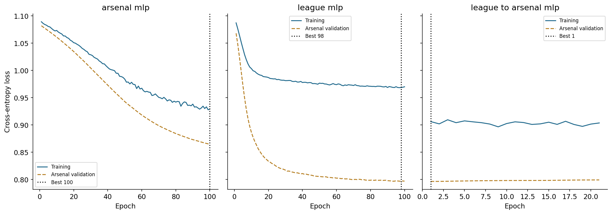
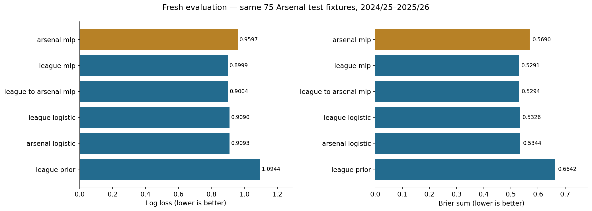

# Premier League Research — from data to results

A fresh, controlled notebook sequence for Arsenal win/draw/loss probabilities. Read it in this order:

1. **[Data sources, combinations, visualization and audit](notebooks/01_data_sources_and_audit.ipynb)**
2. **[Model development, controls and every training epoch](notebooks/02_models_and_training.ipynb)**
3. **[Frozen evaluation and results](notebooks/03_evaluation_and_results.ipynb)**

**Inspect the held-out test:** [load frozen models without retraining](notebooks/Frozen_Model_Test_Review.ipynb) · [all test fixtures and match-by-match verdict tables](results/test_review/README.md). The companion preserves the three-notebook experiment and its artifacts.

Previous generated results and notebooks were removed from the current tree. The new results were produced by executing all three notebooks from an empty model directory; no old model or prediction file is loaded. Earlier work remains recoverable from Git history. [Reset record](docs/reset_2026-10-26.md).

**Reproducibility rerun after test inspection.** This is a fresh execution of fixed methods on a previously inspected test period, not new independent confirmatory evidence.

## 1. Understand the datasets first

| Frozen source | Fixtures | Role | Additional fixtures |
|---|---:|---|---:|
| Reza, 2000/01–2025/26 | 9,880 | Primary match archive | Primary source |
| Tara, 2010/11–2019/20 | 3,800 | Overlapping common-field verification | 0 |
| football-data 2015/16 | 380 | Season cross-check | 0 |
| football-data 2024/25 | 380 | Season cross-check | 0 |
| football-data 2025/26 | 380 | Season cross-check | 0 |

These files are **not concatenated into a larger training sample**. Sources can share upstream lineage; overlap is not proof of independent original observation. The fresh audit reconciles source conflicts and reconstructs all features and splits.



Notebook 01 contains ten data figures: source overlap, season coverage, missingness, xG coverage, all-team coverage, outcomes/goals, eligibility, split class balance, training-feature distributions and correlations. Complete source inventories and table exports are in [data/](results/current/data/). Missing xG is excluded from the fixed model rather than filled with zeros.

| Partition | Seasons | EPL fixtures | Arsenal fixtures |
|---|---|---:|---:|
| Train | 2000/01–2021/22 | 7,977 | 815 |
| Validation | 2022/23–2023/24 | 730 | 74 |
| Test | 2024/25–2025/26 | 732 | 75 |

441 archived fixtures are ineligible because the default lagged features are incomplete. They remain in the frozen input archive.

## 2. Develop and train controlled model arms

**Arsenal-only control → independent league challenger → frozen validation comparison → optional Arsenal specialization → final evaluation.** Only specialization inherits a trained checkpoint, created in this execution.

Settings remain fixed: 39→32→16→3 MLP, ReLU/dropout 0.1, unweighted cross-entropy, AdamW at 1e-4, weight decay 0.01, batch 256, seed 42, maximum 100 epochs, patience 20 and min_delta 1e-4. All neural checkpoints use the same Arsenal validation fixtures. Logistic regression under each training population and the league class prior provide reference controls. [Protocol](EXPERIMENT_PROTOCOL.md).



[Every epoch CSV](results/current/models/all_epochs.csv) · [Every epoch as a table](results/current/models/EVERY_EPOCH.md) · [Live training log](results/current/models/epoch_log.txt) · [Execution timeline](results/current/events.jsonl) · [Initialization and transfer checks](results/current/models/independence_checks.json)

## 3. Evaluate one fresh result set



These are different model arms from one fresh execution, not multiple copies of rerun scores. Seed resets can reproduce the same corresponding model across executions; that is distinct from equality between the trained Arsenal and league models. The fresh checks verify different learned weights and predictions between those arms, plus sensitivity to changed input rows.

[Results and interpretation](docs/study_report.md) · [All metrics](results/current/evaluation/metrics.csv) · [Paired uncertainty](results/current/evaluation/comparison.json) · [Data-sensitivity checks](results/current/evaluation/data_sensitivity_checks.json)

One seed, a previously inspected test period, different optimizer-update budgets and incomplete original-provider lineage limit inference. League logistic remains selected by validation loss; test rankings do not select the candidate. These are historical probabilities, not live forecasts.

## Reproduce and inspect

See [reproduction instructions](docs/reproduction.md). The executor refuses to overwrite an existing current run.

```bash
python -m experiments.execute_study
python -m unittest discover -s tests -v
```

| Folder | Purpose |
|---|---|
| [notebooks/](notebooks/README.md) | Three ordered, executed notebooks |
| [experiments/](experiments/README.md) | Audit, training, inference and sequential execution code |
| [results/current/](results/README.md) | Only the newly executed study: data, audit, models, evaluation and figures |
| [docs/](docs/README.md) | Reproduction, scientific interpretation and reset record |
| [arsenal_predictor_v1/](arsenal_predictor_v1/README.md) | Frozen original inputs and their original metadata |
| [tests/](tests/README.md) | Current-study behavioral and provenance checks |

Third-party source attribution and restrictions remain in [DATA_REUSE_NOTICE.md](DATA_REUSE_NOTICE.md). Repository visibility has not been changed.
