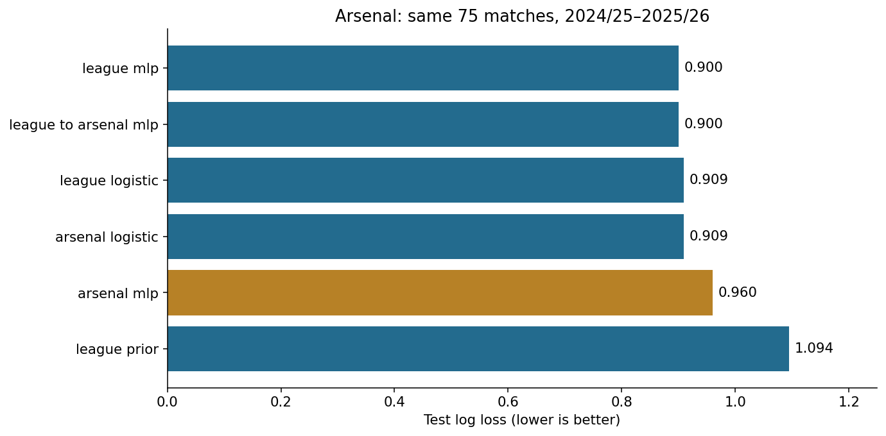

# Premier League Research: Arsenal W/D/L probabilities

[Open the experiment in Colab](https://colab.research.google.com/github/ryandai1/Premier-League-Research/blob/main/notebooks/Arsenal_League_vs_Arsenal.ipynb)

Start with **[the executed notebook](notebooks/Arsenal_League_vs_Arsenal.ipynb)**. It contains raw-data visualization, an explicit cleaning protocol, post-cleaning visualization, training/checkpoint inspection, held-out probabilities, calibration and transfer evaluation.

## First experiment
Does league-wide training improve future Arsenal predictions over Arsenal-only training?

On the **same 75 eligible Arsenal test matches (2024/25–2025/26)**:

| Model | Log loss ↓ | Multiclass Brier ↓ |
|---|---:|---:|
| League MLP | 0.8999 | 0.5291 |
| Arsenal-only MLP | 0.9597 | 0.5690 |
| League → Arsenal fine-tuned MLP | 0.9004 | 0.5294 |
| League logistic | 0.9090 | 0.5326 |
| Arsenal-only logistic | 0.9093 | 0.5344 |
| League class prior | 1.0944 | 0.6642 |

**Claim:** league training improved the neural pipeline in this bounded experiment. The paired log-loss difference was −0.0598, month-block 95% bootstrap interval [−0.1008, −0.0162]. This is one seed, a short historical test and a particular architecture; the logistic comparison was nearly tied. The interval excludes training randomness.

**Selected candidate:** league logistic, chosen on Arsenal validation log loss before test scoring. Do not switch the selected model using test performance. The tiny validation difference from fine-tuned MLP is not evidence of a robust ranking.

**Supporting figure:**



**Limitations:** no live 2026/27 feed, external-league validation, seed sweep, or fully resolved original-provider lineage. Initial neural fits hit the 100-epoch cap; fine-tuning stopped at 21 and selected epoch 1. Other-EPL transfer evaluates known competition/club conditions. Fine-tuning was prespecified before test inspection; future test-informed revisions require a new holdout.

## Reproduce

Python 3.12 was used. For economical CPU setup:

```bash
python -m venv .venv
source .venv/bin/activate
python -m pip install torch==2.5.1 --index-url https://download.pytorch.org/whl/cpu
python -m pip install -r requirements.txt
python experiments/audit.py
python -m unittest discover -s tests -v
# Optional: create a new run, with 100 epochs maximum per fit and patience 20.
python experiments/train.py
```

In Colab, the notebook installs its requirements. `RUN_TRAINING=False` displays the saved run and verifies its hashes; `True` trains and saves a new timestamped run. Download its output archive before ending a temporary runtime. Hosted Colab execution has not been independently run; the notebook was executed top-to-bottom in the cloud Python environment.

## Files and evidence

- `arsenal_predictor_v1/`: complete original ZIP contents, including frozen raw data, cleaned CSVs, splits, schema, source manifest and original scripts/reports. The ZIP itself is unchanged. Its original checksum manifest still verifies every original member.
- `experiments/audit.py`: authoritative current audit; validates all raw/clean/feature/split values, hashes, overlap and temporal invariance. Original v1 verifier reports are historical and should not substitute for this audit.
- `results/audit/`: source record links, rolling-history links, 57-cell correction ledger, corrected season metadata, clean Parquet, live-source check status and current verification report. Corrections are outside raw evidence and do not change the 39 model inputs.
- `experiments/train.py`: fixed AdamW comparison and prespecified fine-tuning; checkpoints include optimizer state, scaler, feature/class order and training configuration.
- `experiments/inference.py`: reload a saved candidate and score already prepared pre-match features. It rejects reordered or missing inputs and converts H/D/A to Arsenal W/D/L.
- `results/run_*/`: best checkpoints, logistic coefficient arrays, histories, metrics, manifests, uncertainty estimates and per-match probabilities. No serialized arbitrary estimator is needed for logistic reload.
- `results/figures/`: five exported figures, also embedded in the notebook.
- [Experiment protocol](EXPERIMENT_PROTOCOL.md) and [data attribution/reuse notice](DATA_REUSE_NOTICE.md).

Use `experiments/check_sources.py` to compare remote hashes without overwriting snapshots. Both pinned GitHub files matched. The three football-data downloads remain unverified remotely because this cloud's proxy returned 403; their bundled contents/hashes and cross-source agreement pass. A domain addition was saved in the environment draft; it requires application in environment settings before retrying here. Missing original-provider lineage and upstream permissions cannot be repaired by code. Reza states CC BY-NC 4.0; no commercial clearance is implied.

This project is not a live forecasting service. It saves historical out-of-time probabilities and an inference interface for correctly prepared future features. Personal workflow preferences are intentionally stored outside this repository.
