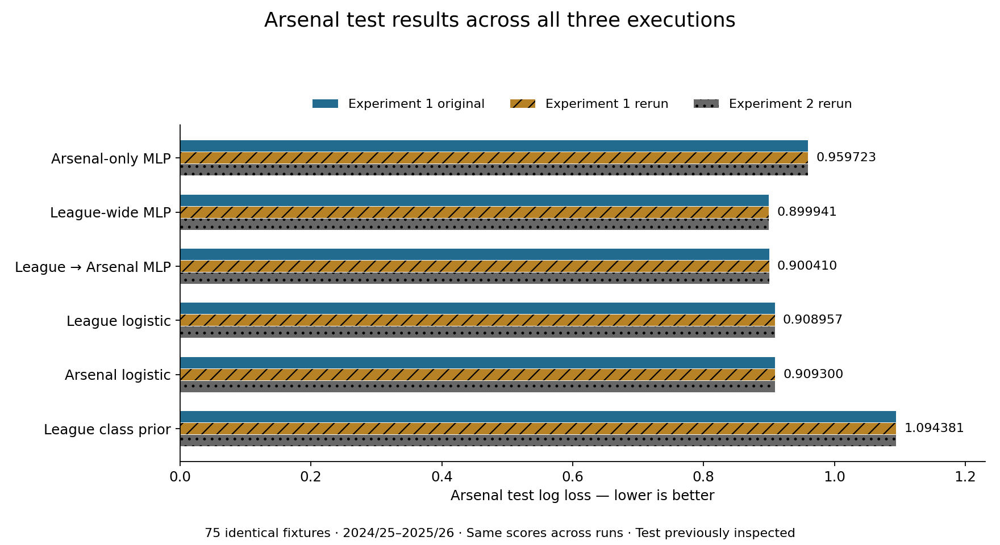
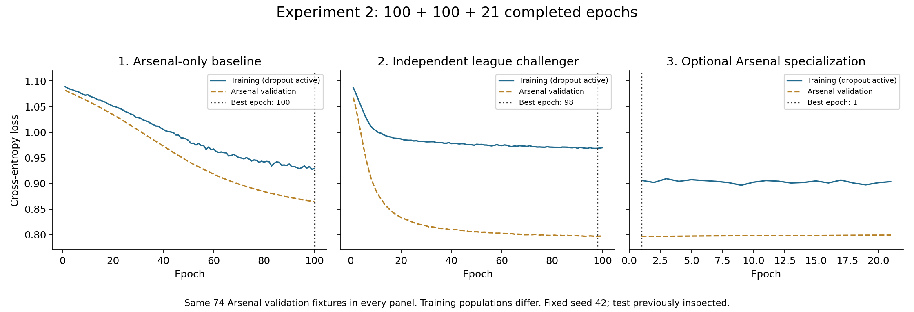

# Arsenal probability modeling — scientific report

## Status and research question

This report summarizes one fixed modeling comparison and its reproducibility reruns. Question: under a fixed architecture and epoch budget, does training on eligible Premier League matches improve future Arsenal win/draw/loss probabilities relative to training only on Arsenal matches?

Experiment 1 defines the original comparison. Experiment 2 reorders its independent fits and adds explicit inspection of their frozen validation results before optional specialization. The subsequent executions reuse a test period whose results were already inspected. They establish reproducibility, not independent confirmatory evidence. No external preregistration is claimed. The original [protocol](../EXPERIMENT_PROTOCOL.md) and historical artifacts remain intact.

## Data and eligibility

The frozen input bundle contains 9,880 archived matches across 26 seasons. Default model eligibility excludes 441 rows lacking sufficient prior observations; 9,439 remain. Modeling uses 39 explicitly allowed, lagged features, with class order A/D/H (away win/draw/home win). Arsenal probabilities are reoriented for home/away reporting without changing the loss.

| Partition | Seasons | Eligible EPL fixtures | Arsenal fixtures | Role |
|---|---|---:|---:|---|
| Train | 2000/01–2021/22 | 7,977 | 815 | Fit preprocessing and model parameters |
| Validation | 2022/23–2023/24 | 730 | 74 | Select checkpoints and deployment candidate |
| Test | 2024/25–2025/26 | 732 | 75 | Evaluate frozen candidates |

Features use prior-date information; no same-day result enters another same-day predictor. Training-only preprocessing is fitted separately for independent training populations. Missing xG is retained in archived data and excluded from the default feature set. Audits document aliases, shot-stat corrections, row lineage, split membership, and exclusions. Eligibility can favor established teams. Exact data definitions and original source attribution remain in [the frozen bundle](../arsenal_predictor_v1/README.md), with current evidence in [results/audit](../results/audit/).

## Control and treatments

This is a computational pipeline comparison on observational match data, not a randomized intervention on clubs.

| Arm | Initialization | Training population | Purpose |
|---|---|---|---|
| Control: Arsenal-only MLP | Fresh, seed 42 | 815 Arsenal training fixtures | Baseline for the primary comparison |
| Treatment: league-wide MLP | Fresh, seed 42 | 7,977 EPL training fixtures, including Arsenal | Test the broader training pipeline |
| Optional extension: league → Arsenal | Best current-run league checkpoint | Same 815 Arsenal training fixtures | Test specialization; retains league scaler, resets AdamW |
| Reference controls | Fixed logistic regression on each population; league class prior | Corresponding training data | Check whether neural complexity is useful |

All neural arms use the same 74 Arsenal validation fixtures. Fresh initialization does not mean different numerical initial values: resetting the same seed reproduces the same starting tensors. The league challenger never receives the trained Arsenal weights. The optional extension alone inherits trained weights. Epoch zero remains eligible for that extension.

Architecture: 39→32→16→3, ReLU, dropout 0.1. Objective: unweighted cross-entropy. AdamW learning rate 1e-4, weight decay 0.01, batch 256. Seed 42; deterministic CPU execution; maximum 100 epochs per fit; patience 20 and min_delta 1e-4. Every true validation minimum is saved; patience resets only on improvement exceeding min_delta relative to the previous best. Best weights are reloaded before scoring. These rules remain as originally implemented.

**Compute qualification:** Arsenal-only receives 4 optimizer updates per epoch, league-wide 32. The study compares practical pipelines under an equal epoch cap, not equal compute or an isolated causal effect of sample size.

## Outcomes and analysis plan

Primary contrast: league MLP minus Arsenal MLP log loss on the same 75 Arsenal test fixtures; negative favors league. Secondary metrics: multiclass Brier **sum** (range 0–2) and accuracy. A paired month-block bootstrap uses 1,000 resamples over 20 calendar-month blocks. The 95% percentile interval measures limited test-sample uncertainty; it does not include training-seed randomness.

Checkpoints and the deployment candidate are selected using Arsenal validation loss only, including the logistic/prior controls. The test ranking does not select the candidate. In experiment 2 the frozen validation comparison is recorded before optional fine-tuning; final test scoring follows fitting and selection. Fine-tuning was enabled as a declared stage, not selected using the new test result.

## Results

| Model | Arsenal test log loss ↓ | Brier sum ↓ | Accuracy |
|---|---:|---:|---:|
| Arsenal-only MLP | 0.959723 | 0.569044 | 60.00% |
| League-wide MLP | 0.899941 | 0.529087 | 61.33% |
| League → Arsenal MLP | 0.900410 | 0.529357 | 61.33% |
| League logistic | 0.908957 | 0.532644 | 61.33% |
| Arsenal logistic | 0.909300 | 0.534445 | 64.00% |
| League class prior | 1.094381 | 0.664183 | 40.00% |

The primary difference is −0.059782, with interval [−0.100787, −0.016194]. League logistic remains the validation-selected candidate. Fine-tuning does not improve test loss here. The two logistic arms are nearly tied.

Arsenal-only selects epoch 100 of 100; league selects 98 of 100; fine-tuning selects 1 of 21. The independent fits reached the cap, so convergence is not established.

Training loss is an online minibatch average with dropout active; validation uses the end-of-epoch model without dropout. Training populations differ across panels; validation populations are identical. Training and validation loss levels are therefore not interchangeable.

The original and rerun predictions, weights, and corresponding epoch losses are identical. The seed resets inside each independent fit. Execution-order changes preserve the numerical procedure. The present repository cleanup makes no attempt to alter this result or choose a new seed.

## Limitations and interpretation

One seed, a short inspected test period, unequal optimizer-update budgets, eligibility exclusions, and related upstream sources limit inference. Other-EPL scoring is temporal/population transfer within the same competition, not external-league validation. Source-file lineage is available; original-observer lineage is incomplete. Bundled football-data files were verified internally but remote authenticity/freshness was not confirmed in the original environment. No live fixture feed or upcoming-game forecasting claim is made.

The evidence supports lower neural test loss for this fixed league-training pipeline on this historical sample. It does not establish a universal advantage, robust seed-level superiority, or improved performance from merely reordering execution. A new untouched period is required for another confirmatory evaluation.

## Reproducibility and evidence

Use the [run catalog](../results/README.md) to distinguish featured and historical executions. Each run retains its manifest, settings, checkpoint, epoch history, selection record, metrics, and per-match probabilities. The [reproduction guide](reproduction.md) identifies exact source commits, environment setup, rerun commands and validation steps. Original evidence is preserved; regenerated HTML previews are the only tracked output deletions in this cleanup. See the [revision log](cleanup_2026-10-26.md) and [deletion ledger](deletions_2026-10-26.csv).
